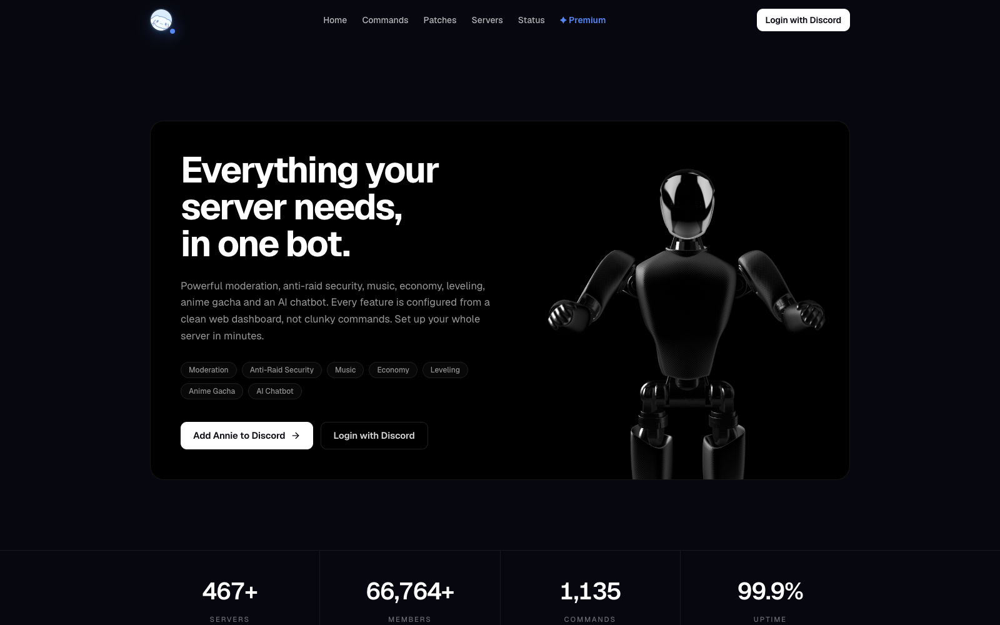
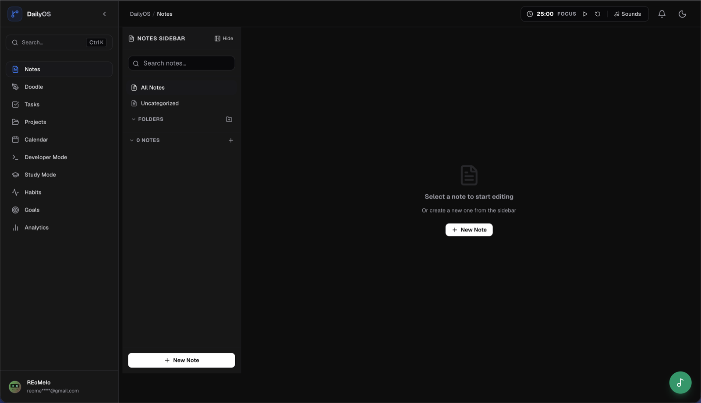
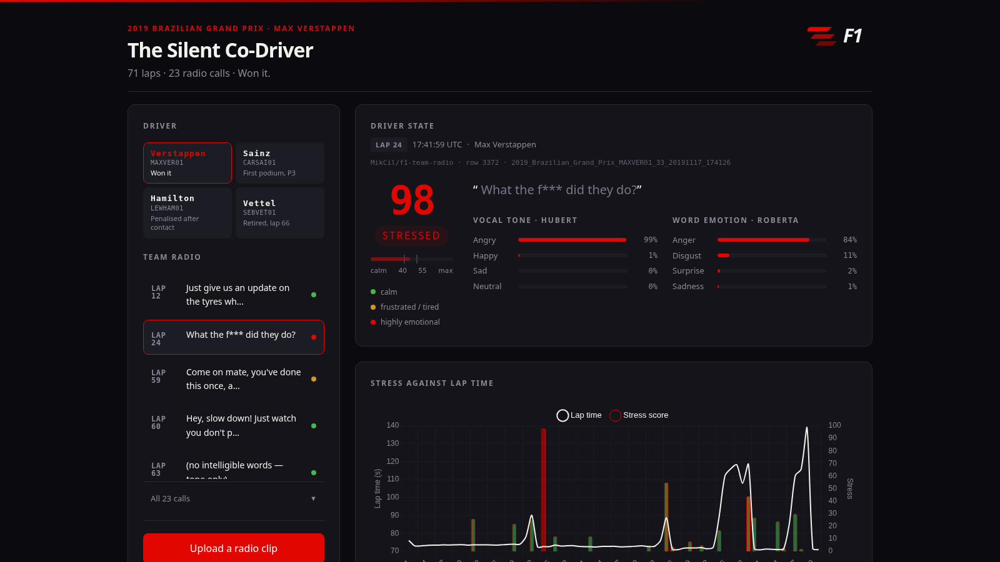

## Abhinav

Full-stack developer in Delhi. I build software and then keep it running: a
Discord bot in 490 servers, an offline-first memory for field crews, and the
productivity app I open every morning. CSE 1st year at GGSIPU.
Everything below is in production, and I'm the one who keeps it there.

[Portfolio](https://yabhinav.dpdns.org) · [LinkedIn](https://www.linkedin.com/in/yabhinav1) · [Email](mailto:yabhinav0011@gmail.com)

<picture>
  <source media="(prefers-color-scheme: dark)" srcset="https://yabhinav.dpdns.org/badge/stats.svg" />
  <source media="(prefers-color-scheme: light)" srcset="https://yabhinav.dpdns.org/badge/stats.svg?theme=light" />
  
</picture>

**Now:** keeping Annie healthy, and building a Discord bot and dashboard for the GeekRoom community.

| | | |
|---|---|---|
| **Annie** | Discord bot that replaces six single-purpose bots. 417 commands, sharded, with a Next.js dashboard. | [annie.monster](https://annie.monster) |
| **DailyOS** | Personal productivity OS. Eleven modules over one Prisma schema. | [live](https://dailyos.dpdns.org) · [source](https://github.com/yabhinav1/dailyos) |
| **FieldMind** | Offline-first memory for field technicians on Qdrant Edge. Team build. | [source](https://github.com/yabhinav1/fieldmind) |
| **FieldProof** | Field photos in, verified and report-ready evidence out. NGO media platform on Cloudinary. | [demo](https://fieldproof-kappa.vercel.app) · [source](https://github.com/yabhinav1/fieldproof) |
| **The Silent Co-Driver** | Scores driver stress from F1 team radio. 3rd place, AI Race Month. Team build. | [source](https://github.com/yabhinav1/silent-co-driver) · [slides](https://docs.google.com/presentation/d/18KpD-N1qZz-IirTM5YQVlFXKfGk4JwXepVmh9bDD5ng/edit?usp=sharing) |
| **Café de' Mercanti** | UI and UX concept for an Old Montreal café. Hand-built in HTML, CSS and JS. | [live](https://cafe-de-mercanti.vercel.app) · [source](https://github.com/yabhinav1/cafe-de-mercanti) |

---

### Annie · [annie.monster](https://annie.monster)

Closed source. An all-in-one Discord bot that replaces the six single-purpose bots most servers
end up running — economy, moderation, music, games, social, community tools.

**417 commands** (313 prefix + 104 slash) across 23 categories · 29 event
listeners · ~125k lines · sharded through `discord.js` `ShardingManager` ·
anti-nuke and automod · a simulated coin market with generated charts.

The dashboard is a separate Next.js app — **~41k lines, 128 API routes** — with
Discord OAuth2, per-guild config panels so nobody has to memorise command syntax,
premium checkout with IPN callbacks, a public status page with incident history,
and rendered ticket transcripts.

<b>The bug I'm most proud of fixing</b>

 

Shards leaked memory on a 2-core container: RSS climbed steadily while the JS
heap stayed flat. It wasn't JavaScript.

glibc's mmap threshold is *dynamic* — it ratchets upward every time a large
buffer is freed. So after the first few canvas/sharp image buffers came and went,
subsequent large allocations started coming from the arena heap (`sbrk`) instead
of `mmap`, and arena memory is never returned to the OS.

Pinning `MALLOC_MMAP_THRESHOLD_` to a fixed 128KB disables the ratchet — every
large allocation uses `mmap`, which *is* returned on free. `MALLOC_ARENA_MAX=2`
stops the container (which reports 16 cores but is limited to 2) from opening
~128 malloc arenas that fragment and never hand memory back.

Both have to be set in code before `manager.spawn()`, not in `.env` — glibc and
libuv read them at process start, before dotenv ever runs.

### DailyOS · [dailyos.dpdns.org](https://dailyos.dpdns.org) · [source](https://github.com/yabhinav1/dailyos)

A personal productivity OS — notes with folders, tasks, projects, calendar,
habits, goals, analytics, study mode, focus timer, doodle canvas, and a developer
mode. Eleven modules over **34 Prisma models in one schema**, so a task can come
from a note and a habit can roll into a goal without an integration in between.

Notes carry three editing modes on one record: rich text, a sketch pad, and a
freeform canvas you double-click to drop text onto. File bytes live in MongoDB
GridFS rather than Postgres, so a large PDF isn't sitting in a row that gets read
on every page load.

Next.js 16, Prisma, Neon, Auth.js v5. Vercel behind Cloudflare.

<b>The bug I'm most proud of fixing</b>

 

Uploading a profile picture signed you out, and everything afterwards crawled.
The two symptoms looked unrelated and had one cause.

An uploaded avatar was stored as a data URL — up to two megabytes — and handed
to `updateSession`, which put it on the session token. That token is serialised
into a cookie, and a cookie holds about four kilobytes. Auth.js does not fail on
that; it *splits* the token across numbered chunks — `authjs.session-token.0`,
`.1`, `.2` — so every subsequent request carried megabytes of cookie. That was
the slowness.

The sign-out was the proxy: it looked for the session cookie by exact name, so
the moment the token was chunked there was no cookie by that name, and a
signed-in user looked signed out.

Matching the chunk prefix fixes the symptom. The actual fix was keeping the
bytes out of the token at all — the jwt callback reads the avatar from the
database and puts a URL on the token, and the image is served from a route. No
future caller can reintroduce it by passing an image either.

### FieldMind · [source](https://github.com/yabhinav1/fieldmind)

Built on **Qdrant Edge** with Team Compilers. A technician records what they see
and do. The device remembers it, searches it in about a millisecond with no
network, answers questions from it with citations, decides by itself what is
safe to share, and syncs with the fleet through Qdrant Server whenever a link
exists.

Two Qdrant Edge shards inside the app process, a third for photos; dense vectors
from `bge-small` on CPU plus built-in BM25. A policy engine classifies every note
in about 20 ms — pattern detectors, a quantised BERT name model and a semantic
classifier — and learns from the technician's overrides without ever keeping the
text. Every change goes to a durable outbox first; uploads are compare-and-swap
writes; a device that is far behind restores from a shard snapshot instead of
pulling a diff. Concurrent edits merge field by field, true clashes wait for a
person, and nothing is overwritten.

### FieldProof · [demo](https://fieldproof-kappa.vercel.app) · [source](https://github.com/yabhinav1/fieldproof)

Code Cubicle 2026. An NGO restoring a riverbank takes thousands of photos over
six months; a donor asks what changed. FieldProof sorts every photo into site and
phase from GPS and EXIF, flags near-duplicates and impossible dates, turns a
before/after pair into a plain-language assessment from a vision model that first
has to agree the two photos show the same spot, searches by meaning, and writes a
donor-ready report in which every image traces back to its original.

Next.js 16, TypeScript strict, Cloudinary for the media pipeline, Postgres with
pgvector for search, Gemini for captions and assessments.

### The Silent Co-Driver · [source](https://github.com/yabhinav1/silent-co-driver) · [slides](https://docs.google.com/presentation/d/18KpD-N1qZz-IirTM5YQVlFXKfGk4JwXepVmh9bDD5ng/edit?usp=sharing)

**3rd place, AI Race Month · GrandPrix** — two-person team, built in a day.

A pit wall watches tyre temps, fuel and sector deltas. Nobody has time to
process the one channel that carries fatigue first: the driver's own voice. This
reads Formula 1 team radio, scores how stressed the driver sounds 0-100, and
lines that score up against his real lap times.

Three Hugging Face models chained — **faster-whisper large-v3** for transcription
with per-word timestamps, **HuBERT** for emotion from the *sound*, **DistilRoBERTa**
for emotion from the *words* — blended 65/35 in favour of tone, because a driver
saying "I'm fine" through gritted teeth is not fine. Vocal energy separates the
two ways of not being okay: stress is loud, fatigue is flat. Thresholds are the
90th percentile measured across 63 real clips, not numbers that felt right.

**278 laps · 72 radio calls · 4 drivers**, one Grand Prix. Radio from a Hugging
Face dataset, lap times from the F1 timing feed via `fastf1`, joined only on a
timestamp. FastAPI backend, no framework on the frontend, and every model runs
locally so it works with the wifi off.

<b>The bug I'm most proud of fixing</b>

 

The transcripts looked fine. But on one clip the loudest part of the waveform had
no words against it.

Whisper was silently dropping whichever speaker talked first. On real team radio
the driver asks and the engineer answers — so we were keeping the engineer's calm
reply and throwing away the driver's question. On a project that exists to read
*the driver's* voice, every score was measuring the wrong person, and nothing
errored.

`vad_filter=True` fixed it: voice-activity detection segments the audio before
transcription instead of letting the decoder decide what counts as speech. The
trade-off is that VAD trims some word starts, so a few transcripts came back
slightly worse — a garbled phrase is a much smaller failure than a missing
speaker, so we kept it and filtered the garbled ones out of the demo.

The join has a similar story. Lap boundaries were first derived by assuming the
race started at 17:10:00 UTC. Lights-out was 17:13:00, so all 34 radio calls sat
two to three laps early — and the chart still looked entirely plausible. Only
loading the session telemetry and using the real `LapStartDate` fixed it.

### Portfolio · [yabhinav.dpdns.org](https://yabhinav.dpdns.org) · [source](https://github.com/yabhinav1/portfolio)

Server-rendered Node with an `/admin` panel, libSQL on Turso, no build step and
no frontend framework. Live counters from Annie, a GitHub contribution heatmap,
a content-security policy that allows only its own two hashed scripts, and the
badge at the top of this page.

### Café de' Mercanti · [live](https://cafe-de-mercanti.vercel.app) · [source](https://github.com/yabhinav1/cafe-de-mercanti)

A UI and UX exercise, not a client site: a one-page website for an Italian espresso
bar in Old Montreal, in plain HTML, CSS and JavaScript. A menu slider with tabs,
dots and swipe, opening hours that highlight today, specials, a gallery, and scroll
reveals. Bodoni Moda and Inter on a coffee palette with a copper accent.

---

### Stack

| | |
|---|---|
| **Frontend** | Next.js · React · TypeScript · Tailwind · Framer Motion · Chart.js |
| **Backend** | Node · Express · Python · FastAPI · MongoDB · Postgres · SQLite / Turso · discord.js |
| **AI & search** | Hugging Face · Whisper · ONNX · Qdrant · pgvector · Gemini · Cloudinary |
| **Infra** | AWS · Oracle Cloud · Vultr · Vercel · Fly.io · Cloudflare · Docker · Linux |

---

<picture>
  <source media="(prefers-color-scheme: dark)" srcset="https://raw.githubusercontent.com/yabhinav1/yabhinav1/output/github-snake-dark.svg" />
  <source media="(prefers-color-scheme: light)" srcset="https://raw.githubusercontent.com/yabhinav1/yabhinav1/output/github-snake.svg" />
  
</picture>

---

Working on something hard? [yabhinav0011@gmail.com](mailto:yabhinav0011@gmail.com)
